<h1 align="center">
  &nbsp; Open Media
</h1>

本地媒体创作工作台，包含录屏、片段转 GIF、视频生成、图像生成、歌曲生成、视频转换、图片编辑和工程剪辑。AI 模型由主应用统一管理，各工作区衔接采集、生成、编辑与导出，支持浅色、深色和跟随系统主题。

[下载最新版本](https://github.com/ecojust/open-media/releases/latest) · [使用指南](docs/USAGE.md) · [MCP 接口](docs/MCP.md) · [常见授权问题](docs/USAGE.md#macos-授权与启动提示)

<picture>
  <source media="(prefers-color-scheme: dark)" srcset="docs/screenshots/editor-dark.png">
  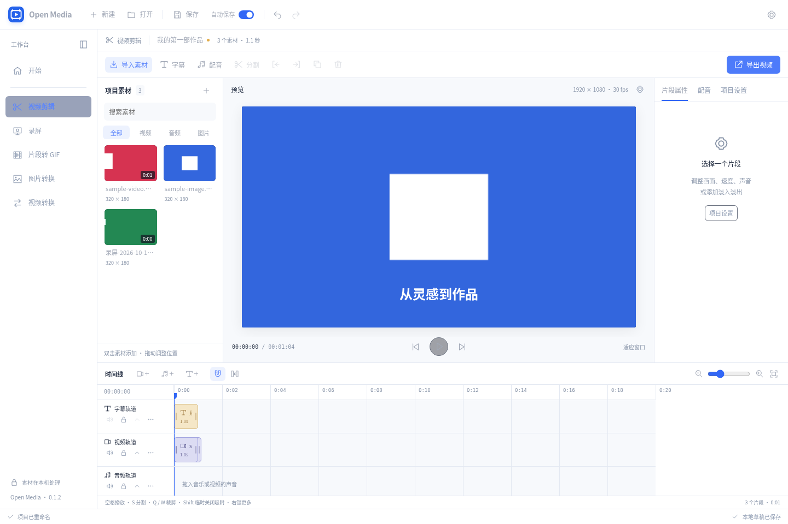
</picture>

*封面为 40 秒科普短片：10 个素材、8 条轨道、45 个片段。截图随页面主题切换；示例内容、对应版本与拍摄说明见[截图说明](docs/screenshots/README.md)。*

## 功能模块

| 工作区 | 主要能力 |
| --- | --- |
| [屏幕录制](#屏幕录制) | 窗口、整屏与区域录制，尺寸选择、暂停继续、麦克风来源、快捷键截屏与自动复制 |
| [片段转 GIF](#片段转-gif) | 多区间截取与重排，尺寸、帧率、画质和循环设置，动图预览与导出 |
| [视频生成](#视频生成) | 提示词、首尾帧、参考素材与分镜，低内存模式、任务进度及剪辑入库 |
| [图像生成](#图像生成) | 文生图与图生图，画幅、步数、种子和重绘强度，结果衔接图片编辑 |
| [歌曲生成](#歌曲生成) | 歌词歌曲与纯音乐，风格、时长、节拍、调性与语言，音频试听及剪辑入库 |
| [视频转换](#视频转换) | 批量转码、片段截取、分辨率与码率设置、音频提取 |
| [图片编辑](#图片编辑) | 画布缩放、文字与笔触、刻度裁剪、旋转翻转、多格式导出和剪贴板复制 |
| [工程剪辑](#工程剪辑) | 多轨编辑、字幕与配音、滤镜、转场与音效、水印、片头片尾、音乐和工程保存 |

公共素材分别保存在 `recording`（录屏）、`screenshot`（截屏）、`videogen`（视频生成）、`imagegen`（图像生成）和 `musicgen`（歌曲生成）。各工作区列表中的素材可右键添加到工程，原文件保留；工程使用 `projects/<工程 ID>/assets` 管理自己的素材副本。

### 屏幕录制

选择窗口、整屏或区域并设置输出尺寸，支持麦克风来源选择。录制范围以红框标示，悬浮操作栏提供计时、暂停／继续、麦克风开关和停止；开始采集时自动收起应用。快捷键截屏完成后自动复制到剪贴板，并进入图片编辑。

<picture>
  <source media="(prefers-color-scheme: dark)" srcset="docs/screenshots/record-dark.png">
  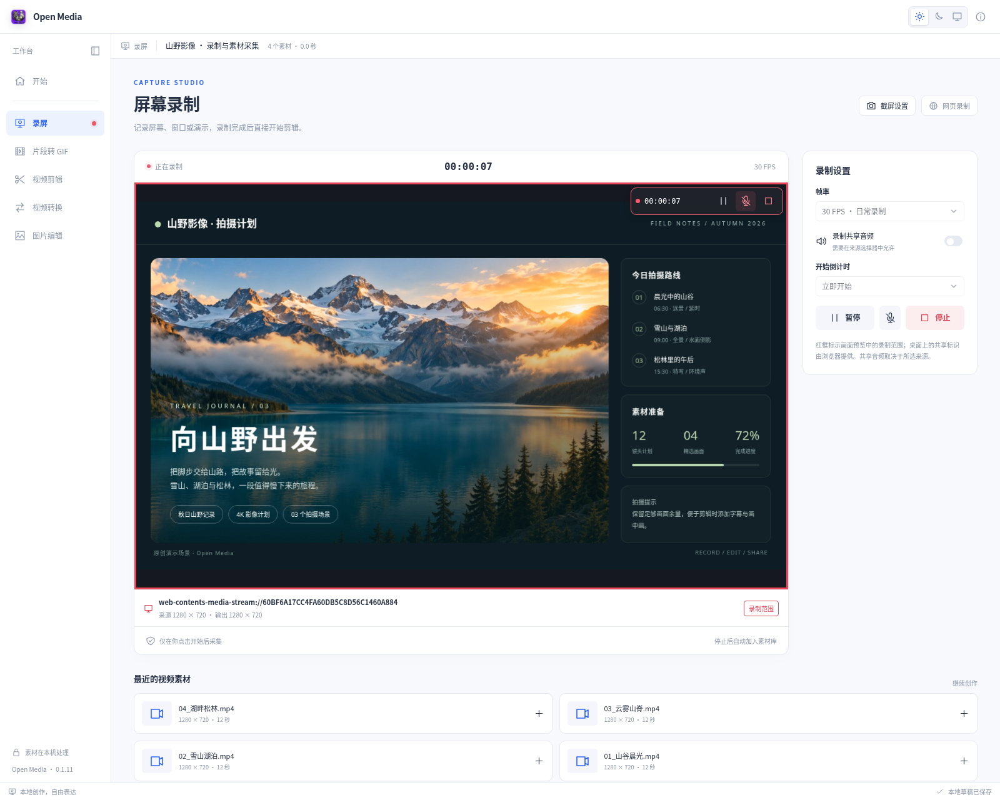
</picture>

### 片段转 GIF

从视频截取多个区间并调整顺序，设置尺寸、帧率、画质和循环方式，预览后导出动图。桌面端左侧自动读取录屏和视频生成目录，按时间排序，也支持手动导入视频。

<picture>
  <source media="(prefers-color-scheme: dark)" srcset="docs/screenshots/gif-dark.png">
  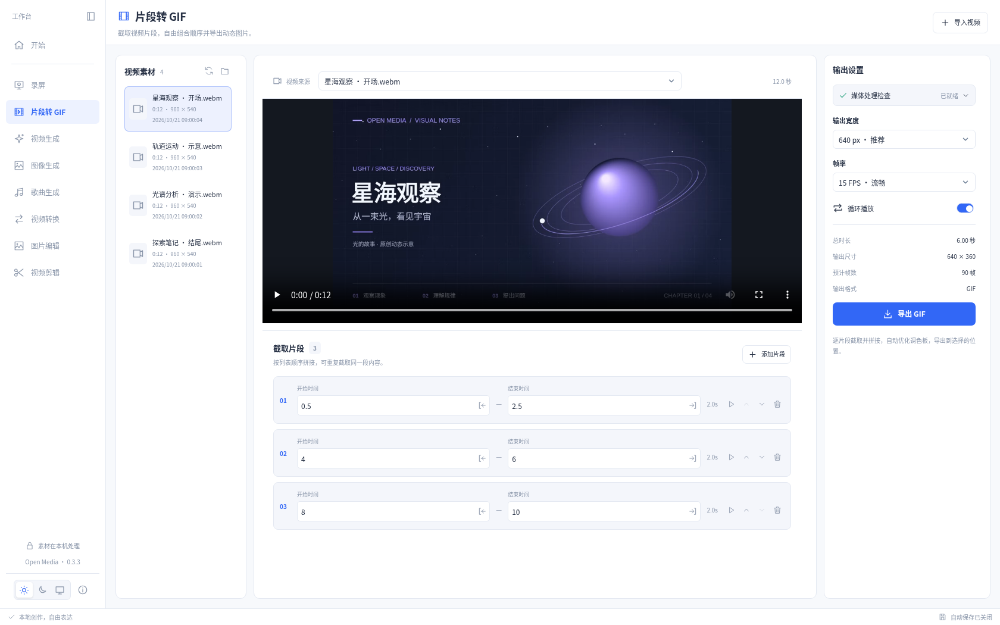
</picture>

### 视频生成

支持提示词、图片首尾帧、多素材参考和分镜生成；分镜可调整顺序与时长，分别保留或合并输出。提供画幅、步数、种子与低内存模式，后台任务显示阶段、进度和耗时，支持取消；完成的结果可预览并加入剪辑。

当前本地视频后端支持 macOS 15 及以上的 Apple 芯片 Mac，模型按需下载。硬件、磁盘需求与实际验证范围见[视频生成说明](docs/VIDEO_GENERATION.md)。

<picture>
  <source media="(prefers-color-scheme: dark)" srcset="docs/screenshots/video-generation-dark.png">
  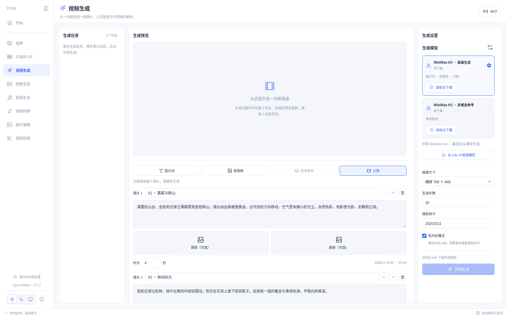
</picture>

### 图像生成

提供 Qwen-Image 和 Z-Image-Turbo，支持文字生成图片及基于原图重绘。可设置画幅、步数、随机种子和重绘强度，结果可加入素材、时间线或图片编辑，继续添加文字与标注。

<picture>
  <source media="(prefers-color-scheme: dark)" srcset="docs/screenshots/image-generation-dark.png">
  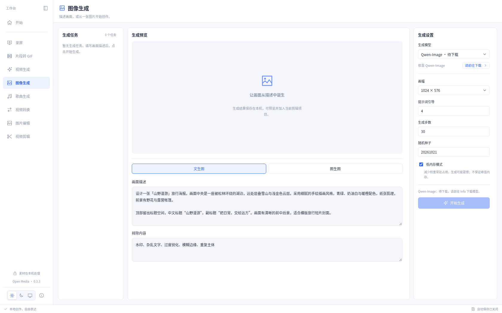
</picture>

### 歌曲生成

支持自备歌词生成歌曲，也可生成纯音乐；提供风格描述、时长、节拍、调性和演唱语言设置。快速与标准模型按需下载，生成音频可试听并加入剪辑工程。

<picture>
  <source media="(prefers-color-scheme: dark)" srcset="docs/screenshots/music-generation-dark.png">
  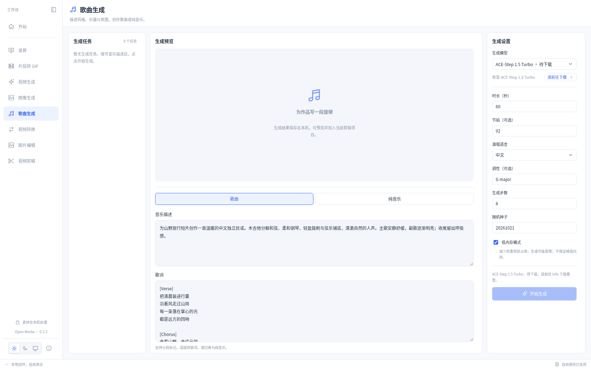
</picture>

### 视频转换

批量转换视频或提取音频，设置输出格式、分辨率、帧率、码率、采样率与截取区间。任务独立显示进度和结果，支持取消、预览及导出。桌面端素材列表自动读取 `recording` 与 `videogen`，支持手动导入；右键可将素材加入当前工程。

<picture>
  <source media="(prefers-color-scheme: dark)" srcset="docs/screenshots/video-convert-dark.png">
  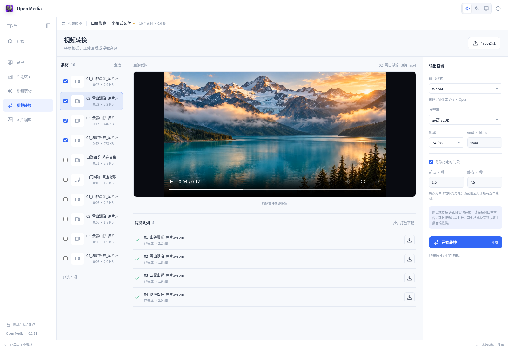
</picture>

### 图片编辑

在当前预览画布中完成文字、画笔、荧光笔、虚线笔触和刻度裁剪，支持缩放、平移、旋转翻转及撤销重做。裁剪与标注即时反映到预览，手动复制和导出保留编辑效果；每张图片独立保存编辑状态，自动载入 `screenshot` 目录中的截图和 `imagegen` 目录中的生成图片，按时间合并展示。

支持 PNG、JPEG、WebP、BMP、ICO、静态 GIF、TIFF 等格式及批量输出，多尺寸 ICO 可包含多种图标规格。

<picture>
  <source media="(prefers-color-scheme: dark)" srcset="docs/screenshots/image-edit-dark.png">
  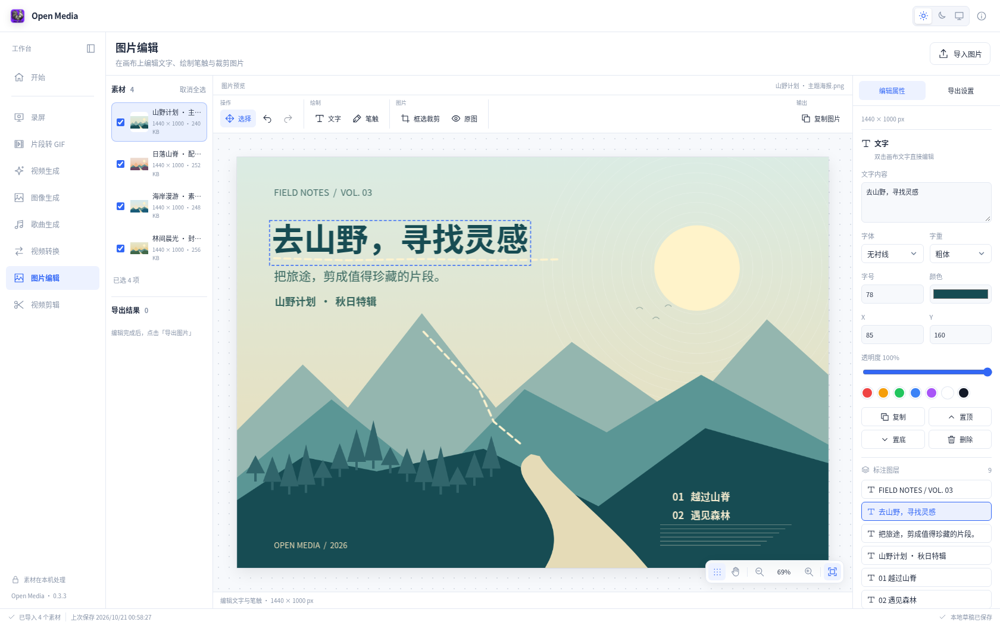
</picture>

### 工程剪辑

- **多轨编排**：轨道拖拽排序，片段分割、裁切、吸附与删除接拢，Ctrl + 滚轮缩放时间线；字幕、水印和画中画支持在预览中拖动定位。
- **素材二创**：在 MCP 设置中选择工程素材、视觉风格与创作目标，由外部 Agent 分析内容、规划分镜和节奏，再调用本地渲染与剪辑工具完成视频；内置 15 种风格。
- **画面与动效**：实时调整工程尺寸，滤镜调色、关键帧、裁剪聚焦、定格与变速；淡化、缩放、几何、碎片和切片转场，搭配可编辑水印、标注、片头与片尾。
- **字幕与声音**：字幕文件导入导出、样式复用、空文本检测，离线文字转语音、批量进度、配音时长对齐和麦克风录音；背景音乐、音频循环、响度处理及人声避让。
- **效率与预览**：视频压缩工作副本、静止画面检测与黄色 `repeat` 标记，节奏检查、声画对齐、局部视频／音频预览、章节标记和导出检查，保留原始素材。
- **工程管理**：每个工程拥有独立文件夹与素材副本，顶部名称旁可切换历史工程；素材按全部、视频、图片、音频分类，不自动引入其他工作区文件。支持新建、打开、保存与另存为、自动保存、命名版本和撤销重做。

<picture>
  <source media="(prefers-color-scheme: dark)" srcset="docs/screenshots/editor-dark.png">
  
</picture>

**素材二创**在 MCP 弹窗中启用，选择当前工程素材及纸感手绘、科技视窗、杂志拼贴、霓虹复古等风格，也可填写创作目标。配置随工程保存；外部 Agent 接到用户指令后读取配置，理解素材并规划分镜、文案与节奏，调用本地工具生成实际视频，再继续剪辑。Open Media 提供渲染与编辑能力，策划使用 Agent 自身的大语言模型。开启选项本身不会开始生成。完整流程见[素材二创说明](docs/MOTION_STYLES.md)。

<picture>
  <source media="(prefers-color-scheme: dark)" srcset="docs/screenshots/motion-style-dark.png">
  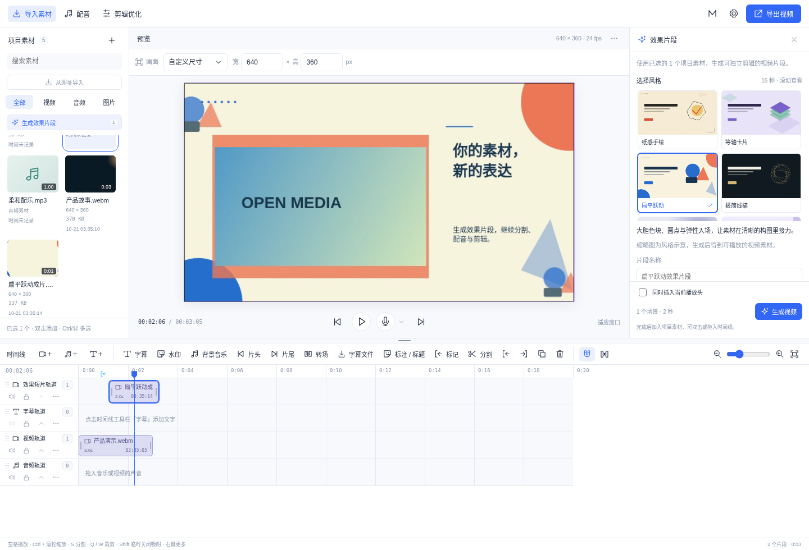
</picture>

**转场音效**内置 10 款原创短音效，可离线试听，将重音对齐视频切点后加入独立音频轨道。音效支持位置、音量、时长及淡入淡出调整，参与预览和导出，也可通过 MCP 添加。

<picture>
  <source media="(prefers-color-scheme: dark)" srcset="docs/screenshots/transition-sounds-dark.png">
  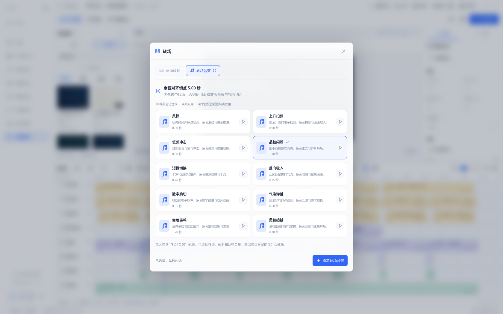
</picture>

## 共享模型中心

Info 集中管理配音、图像、视频、歌曲和语音识别模型，按类别折叠显示下载状态、大小与硬件要求。支持备用下载来源自动切换、断点续传、文件校验、粗略剩余时间估算及已下载模型检查修复；下载和任务状态跨工作区共享。

主应用内置基础离线配音，额外模型按需下载，所需运行组件由模型中心统一管理。生成能力、设备支持、模型占用及完整推理验证范围见[共享 AI 模型说明](docs/AI_MODELS.md)。

<picture>
  <source media="(prefers-color-scheme: dark)" srcset="docs/screenshots/model-center-dark.png">
  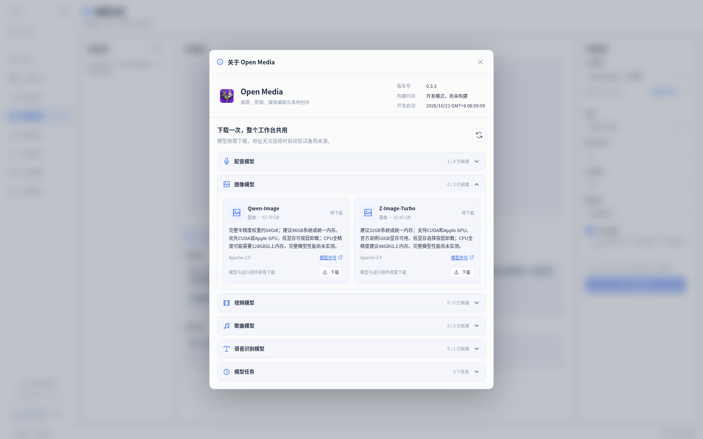
</picture>

## MCP 自动化

桌面端提供 MCP 服务和可复制的连接配置，外部 AI 可操作**当前打开的工程**，覆盖素材导入、轨道与片段、字幕、滤镜、转场及音效、配音、模型管理、媒体生成、预览检查与导出。界面显示连接状态、正在调用的工具和任务进度；批量编辑支持版本校验与整体撤销。

工程的新建、打开和切换由用户完成。完整能力、调用示例和异步任务说明见 [MCP 文档](docs/MCP.md)。

<picture>
  <source media="(prefers-color-scheme: dark)" srcset="docs/screenshots/mcp-dark.png">
  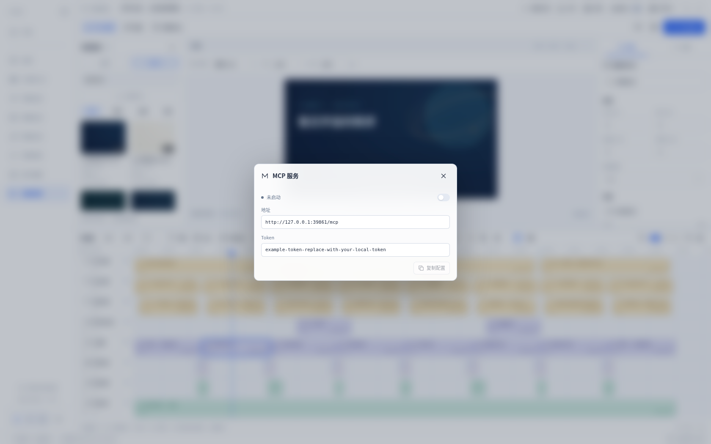
</picture>

## 本地创作与保存

素材保留原件，导出生成新文件。`.omedia` 项目可携带素材和时间线继续编辑；自动保存保留本地草稿，手动保存覆盖当前项目文件，另存为选择新位置。

桌面安装包内置媒体处理和基础离线语音组件。网页端支持浏览器屏幕采集、剪辑、动图与常用图片处理，视频导出采用 WebM；可用格式以当前环境界面为准。屏幕和麦克风仅在主动操作并完成授权后采集。

详细操作、快捷键、格式说明和 macOS 权限恢复见[使用指南](docs/USAGE.md)。

## 开发

前端需要 Node.js 24：

```sh
npm ci
npm run dev
```

桌面开发、运行时准备与验证见[媒体运行时说明](docs/MEDIA_RUNTIME.md)、[语音运行时说明](docs/SPEECH_RUNTIME.md)和[录屏验证记录](docs/RECORDING_CHECK.md)。

```sh
npm test
npm run build
npm run test:browser
cargo test --manifest-path src-tauri/Cargo.toml --no-default-features --locked --lib
```

## 许可证与分发

主应用代码采用 [MIT 许可证](LICENSE)。独立媒体与语音进程按各自许可证分发，语音启动组件采用 GPL-3.0-or-later。来源、固定版本和构建方式见[第三方声明](THIRD_PARTY_NOTICES.md)、[媒体运行时文档](docs/MEDIA_RUNTIME.md)与[语音运行时文档](docs/SPEECH_RUNTIME.md)。发行包同时提供完整媒体及语音运行时对应源码；请保留所有原有版权和许可证资料。

发布流程见 [发布约定](.github/RELEASING.md)。
