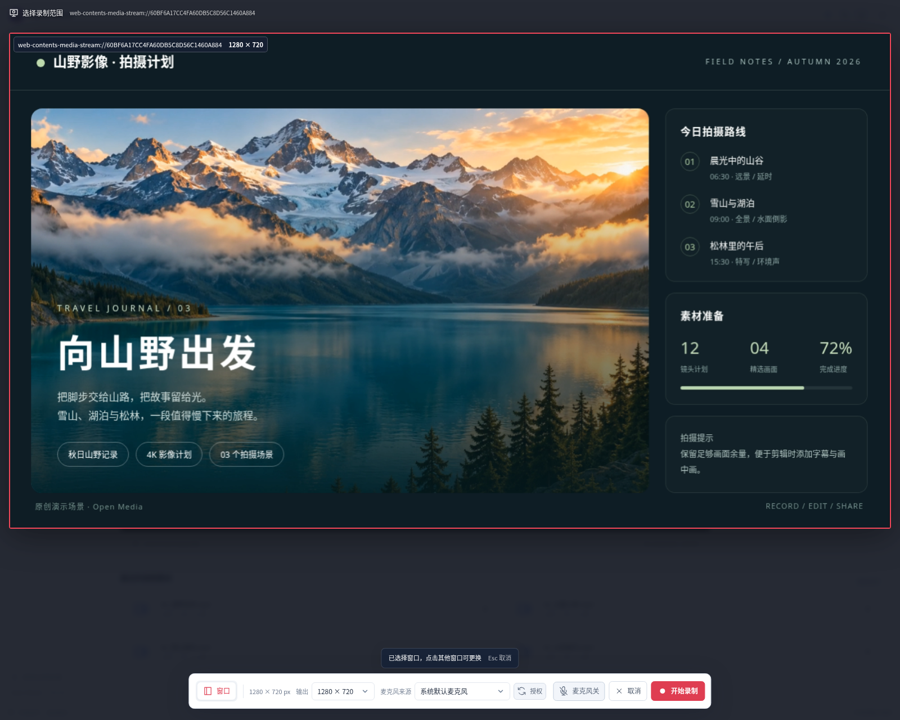
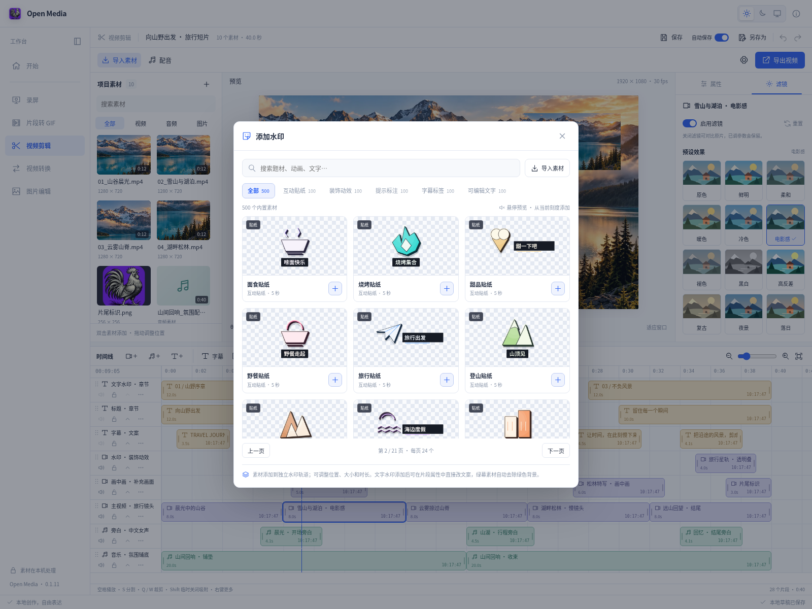
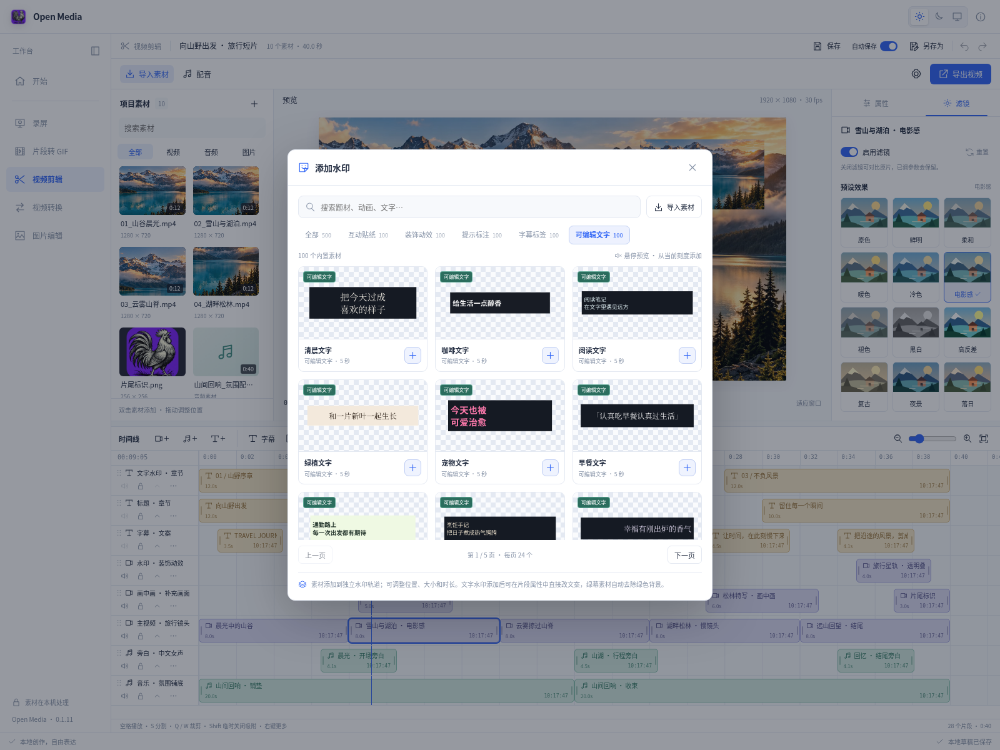
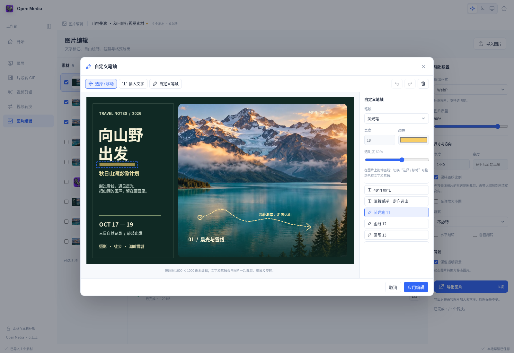
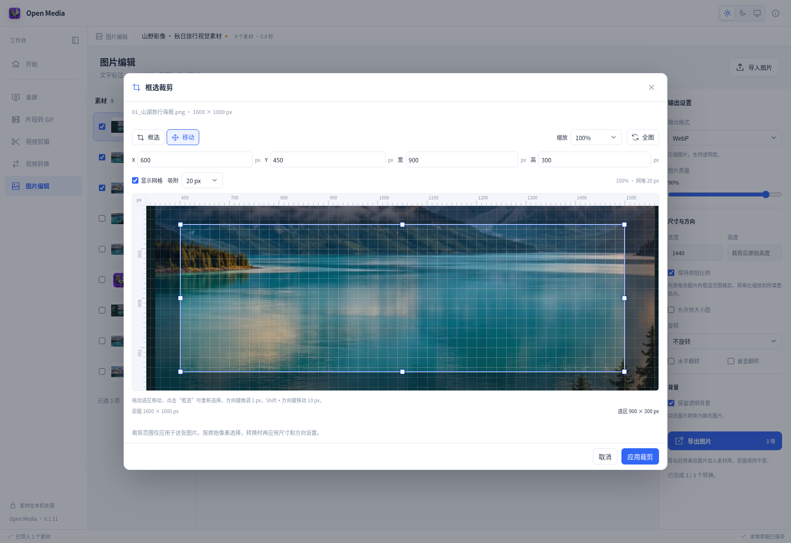

<h1 align="center">
  &nbsp; Open Media
</h1>

本地录屏、分段 GIF、视频剪辑、视频转换与图片编辑工作台。五个工作区共享素材，在同一项目中完成采集、创作与导出；支持浅色、深色和跟随系统主题。

[下载最新版本](https://github.com/ecojust/open-media/releases/latest) · [使用指南](docs/USAGE.md) · [常见授权问题](docs/USAGE.md#macos-授权与启动提示)

<picture>
  <source media="(prefers-color-scheme: dark)" srcset="docs/screenshots/editor-dark.png">
  
</picture>

*40 秒旅行短片：10 个素材、8 条轨道、28 个片段。下面展示各工作区的完整创作场景，截图随页面主题切换。*

## 功能示例

| 工作区 | 主要能力 |
| --- | --- |
| [屏幕录制](#屏幕录制) | 窗口、整屏与区域选择，录制尺寸、暂停继续、麦克风来源、快捷键截屏与自动复制 |
| [片段转 GIF](#片段转-gif) | 多区间截取、片段重排、尺寸与帧率、循环设置、动图预览与下载 |
| [视频剪辑](#视频剪辑) | 多轨编排、吸附与裁切、画中画、字幕、滤镜、转场、片头片尾、水印、背景音乐、离线配音与麦克风录音 |
| [视频转换](#视频转换) | 批量处理、格式转换、分辨率、帧率与码率、片段截取、音频提取 |
| [图片编辑](#图片编辑) | 文字与笔触、刻度裁剪、旋转翻转、批量导出、多尺寸 ICO 与剪贴板复制 |

### 屏幕录制

交互选择窗口、整屏或区域并设置输出尺寸；录制范围以红框标示，悬浮操作栏提供计时、暂停／继续、麦克风开关和停止。截屏可选择范围，完成后自动复制并进入图片编辑。

<picture>
  <source media="(prefers-color-scheme: dark)" srcset="docs/screenshots/record-dark.png">
  
</picture>

*网页录屏示例：采集「山野影像」演示页，输出 1280 × 720 画面，素材列表同时呈现四段旅行镜头。*

<details>
<summary>查看录制来源与输出尺寸选择</summary>



</details>

### 片段转 GIF

从同一个视频截取多个时间区间，调整片段顺序、输出尺寸、帧率、画质和循环方式；预览选段与生成后的动图，并直接下载结果。

<picture>
  <source media="(prefers-color-scheme: dark)" srcset="docs/screenshots/gif-dark.png">
  
</picture>

*示例：将山谷、雪山、云雾和松林四个片段组合为 6 秒循环动图，输出宽度 640 像素、12 FPS。*

### 视频剪辑

多轨时间线支持拖动排序、分割裁剪、删除接拢和吸附定位。字幕、水印和画中画可在预览中直接拖动对齐；视频片段支持 12 种滤镜与参数调色。内置 10 种风格的纯音乐，支持试听、本地上传和独立背景音乐轨道。配音内置中英混合女声，另有按需下载的离线音色，支持本地试听、批量文字转语音、文字时长对齐及麦克风录音。

画面尺寸可在预览上方实时调整，字幕背景随每行文字宽度绘制。内置 **15 种转场**，包含居中及四侧锚定的缩放淡入淡出（100% → 80% → 100%），在独立轨道中围绕视频切点前后各应用一半时长；“片头”和“片尾”分别提供 **5 款动态模板**，标题可编辑，也支持导入本地视频。片头插入项目开头并同步后移原有轨道，保持字幕、声音与画面对齐；片尾追加到项目结尾。

桌面端内置 [MCP 服务](docs/MCP.md)，外部 AI 可通过 84 个工具操作工程、轨道、字幕、滤镜、转场、素材、配音及视频导出，修改同步到当前剪辑界面。

素材右键菜单提供媒体信息、取帧、联系表、场景检测和离线文字识别。片段属性支持关键帧、裁剪聚焦、定格、变速与音频处理；字幕和配音面板提供字幕文件、发音词典、时长预估与对齐策略。可生成局部视频或音频预览，添加章节标记，保存命名版本，并检查导出问题。离线语音识别模型按需下载，支持中英文及带时间戳的识别结果。

封面示例同时编排标题、字幕、画中画、主视频、动态水印、旁白和配乐。内置水印库含 **五类共 500 个素材，每类 100 个**，其中 100 个文字模板可直接编辑文案与样式。

<picture>
  <source media="(prefers-color-scheme: dark)" srcset="docs/screenshots/watermarks-dark.png">
  
</picture>

<details>
<summary>查看可编辑文字水印模板</summary>

<picture>
  <source media="(prefers-color-scheme: dark)" srcset="docs/screenshots/text-watermarks-dark.png">
  
</picture>

</details>

### 视频转换

批量转换视频，设置输出分辨率、帧率、视频与音频码率、采样率和截取区间。每项任务独立显示进度与结果，支持取消、预览和下载；桌面端支持 MP4、MOV、MKV、WebM 及常见音频格式。

<picture>
  <source media="(prefers-color-scheme: dark)" srcset="docs/screenshots/video-convert-dark.png">
  
</picture>

*示例：四个视频截取 1.5–7.5 秒区间，设置为 720p、24 FPS、4500 kbps 并批量生成 WebM；图中的完成项均为实际转换结果。*

### 图片编辑

插入多段文字并调整字体、字号、颜色和位置；使用画笔、荧光笔及虚线笔触自由标注，支持撤销与重做。裁剪确认后即时更新主预览，复制和导出均包含当前编辑效果。

支持旋转、翻转、尺寸与背景设置，以及 PNG、JPEG、WebP、BMP、ICO、静态 GIF、TIFF 等格式。每张图片保留独立裁剪与标注，多尺寸 ICO 可同时包含多种图标规格。

<picture>
  <source media="(prefers-color-scheme: dark)" srcset="docs/screenshots/image-edit-dark.png">
  
</picture>

<details>
<summary>查看文字与笔触编辑、刻度裁剪</summary>

<picture>
  <source media="(prefers-color-scheme: dark)" srcset="docs/screenshots/image-tools-dark.png">
  
</picture>

<picture>
  <source media="(prefers-color-scheme: dark)" srcset="docs/screenshots/image-crop-dark.png">
  
</picture>

</details>

## 本地创作与保存

素材保留原件，导出生成新文件。`.omedia` 项目可携带素材和时间线继续编辑；自动保存保留本地草稿，手动保存与另存为用于项目文件。

桌面安装包内置媒体处理和离线语音组件。网页端支持浏览器屏幕采集、剪辑、动图与常用图片处理，视频导出采用 WebM；可用格式以当前环境界面为准。屏幕和麦克风仅在主动操作并完成授权后采集。

详细操作、快捷键、格式说明和 macOS 权限恢复见[使用指南](docs/USAGE.md)。

## 开发

前端需要 Node.js 24：

```sh
npm ci
npm run dev
```

桌面开发、运行时准备与验证见[媒体运行时说明](docs/MEDIA_RUNTIME.md)、[语音运行时说明](docs/SPEECH_RUNTIME.md)和[录屏验证记录](docs/RECORDING_CHECK.md)。

```sh
npm test
npm run build
npm run test:browser
cargo test --manifest-path src-tauri/Cargo.toml --no-default-features --locked --lib
```

## 许可证与分发

主应用代码采用 [MIT 许可证](LICENSE)。独立媒体与语音进程按各自许可证分发，语音启动组件采用 GPL-3.0-or-later。来源、固定版本和构建方式见[第三方声明](THIRD_PARTY_NOTICES.md)、[媒体运行时文档](docs/MEDIA_RUNTIME.md)与[语音运行时文档](docs/SPEECH_RUNTIME.md)。发行包同时提供完整媒体及语音运行时对应源码；请保留所有原有版权和许可证资料。

发布流程见 [发布约定](.github/RELEASING.md)。
