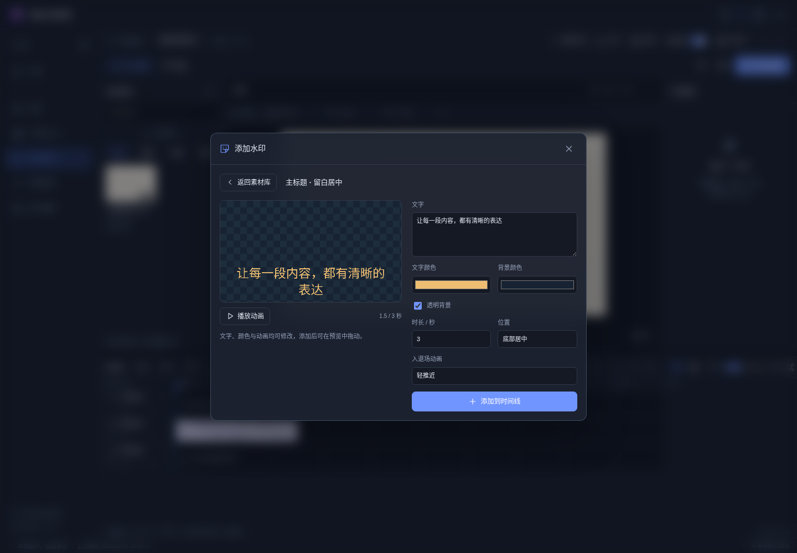
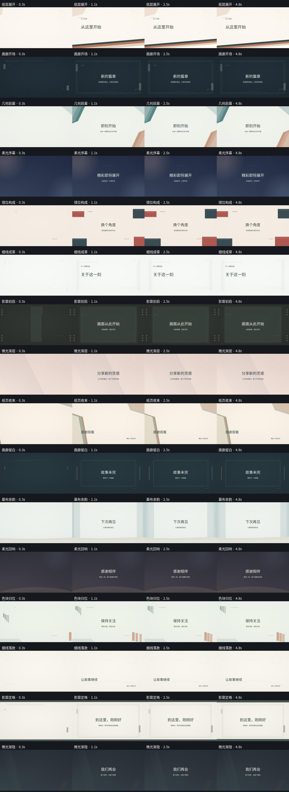

# 通用素材设计与研究

研究日期：2026-10-18。本轮将素材按标题、说明、强调、对比、章节和收束等用途组织，内容、配色和位置由使用者决定。素材中不包含研究视频的画面、人物、音乐或品牌包装。

**当前进度：目标 1,000 条，实际审阅 910 条；排除 11 条确认同源内容及 1 条全白样本后，保留 898 条有效四点样本，共 3,592 张画面，还差 102 条。** 采集期间站点网络通道持续返回 HTTP 503，退避后仍未恢复，尚未取得的内容不计入研究成果。已有样本和排除依据已归档，可据此继续补齐。

## 研究方法

本轮以公开时间轴预览的四个分布时间点观察版式，逐条记录来源、实际时间、可见元素和可复用建议。四张样图只支持构图观察，不能证明完整的动画过程；另取短区间连续画面核查入场、停留、退出和镜头变化。最终数量、排除项及观察记录见 [研究索引](research/general-video-study-2026-10-18.json)。

每条记录保留视频地址、样张时间、联系页摘要及审阅状态。相同编号不重复计数；已确认同源画面和不可辨认样本排除后补样。部分来源的公开预览只覆盖视频前段，索引单独注明；这些样本不用于推断结尾。短区间核查也不等于完整观看视频。

连续观察覆盖 15 条视频的 17 个短区间，合计 94 秒、376 帧（4 fps）；扣除区间重叠后为 91 秒。它们属于本轮样本的子集，不与静态样本数相加。以下为可定位复核的例子：

| 来源 | 视频内区间 | 连续画面可确认的细节 |
| --- | --- | --- |
| [面板交换](https://www.bilibili.com/video/BV1ya41147QN/) | 01:20–01:25 | 原图退场后短暂留白，新文字面板由右进入，重点和箭头随后保持位置。 |
| [结论信息条](https://www.bilibili.com/video/BV1dC411L7ut/) | 00:21–00:26 | 表格先保持，底部结论条稍后出现，主体上移让出阅读空间。 |
| [引线说明](https://www.bilibili.com/video/BV1er4y1J7dH/) | 00:45–00:50 | 目标点、折线和标签先退出，再重新构图主体。 |
| [章节停留](https://www.bilibili.com/video/BV1SA411m7Kb/) | 00:39–00:45 | 章节主标题稳定展示两秒以上，遮片只用于离开章节页。 |
| [局部信息入场](https://www.bilibili.com/video/BV1kZ4y1b7Ew/) | 00:03–00:09 | 小窗放大后保持，退出时主体不动；后续信息行和状态标记分次进入。 |

## 从观察到实现

| 反复出现的做法 | 本轮实现 |
| --- | --- |
| 主标题、副标题、角标和来源说明有稳定层级 | 24 款原生文字布局，文案、字体、颜色、背景、位置、尺寸和时长可继续调整。 |
| 说明短暂进入后保持，阅读时不反复晃动 | 8 个入退场选项，包括无动画、淡入淡出、四方向滑入、轻推近和轻缩回；中间保留稳定阅读区间。 |
| 主体保持稳定，只标注当前目标 | 新增椭圆、括角、双向箭头、折线引注、下划线和勾选；与原有标注合计 12 种，支持颜色、线宽及关键帧。 |
| 片头提出主题，片尾独立收束，装饰避开文字 | 16 款原创动态背景，片头片尾各 8 款；文字分层，提供居中、左侧眉题、下方结语与署名三种布局。 |
| 不同镜头使用一致方向和节奏 | 将现有 23 种转场分为淡化、方向、几何、缩放四组，提供方向、缓动、作用范围及相关颜色、模糊参数。 |
| 同一布局适用于不同内容 | 素材库默认展示“通用样式”，添加前即可定制；保留原有分类和素材标识，旧项目可继续打开。 |

动画写入项目原生关键帧。应用新的入退场预设会替换位置、缩放、透明度及淡入淡出设置，保留旋转、音量关键帧；界面在应用前说明影响。片头片尾通过变速使用完整背景动画，标题作为独立文字片段进入时间线。背景内部图形仍是已编码视频，不能逐个改色或移动。

查看 16 款片头片尾的入场、停留与收尾画面

## 素材与接口

- 水印库共 548 项，其中 132 项为原生可编辑文字；本轮新增 24 项通用文字布局。
- 片头片尾共 38 项，片头和片尾各 19 项；本轮新增 16 项通用背景，视频文件合计约 0.38 MB。
- 标注形状共 12 种，本轮新增 6 种；转场共 23 种，本轮完善分类与参数，不重复计算为新增转场。
- `material_list` 支持 `collection: "general"`；`material_add` 支持文字、颜色、背景、位置、时长、入退场动画和片头片尾布局。具体参数见 [MCP 说明](MCP.md)。

## 验证与后续研究

本轮通过 591 项核心测试和静态类型检查。真实界面验证覆盖定制、动画预览、旧素材访问、转场参数、撤销与重做、便携项目保存重开；实际生成并完整解码了含文字和转场的视频，以及片头布局、原生标注的视频。素材文件另外检查摘要、尺寸、帧数、时长和解码结果。没有构建应用安装包。

可复用验证入口：`tests/browser/general-materials.cjs`、`tests/browser/editor-transitions-segments.cjs`，以及通用水印、片头片尾、关键帧和 MCP 的核心测试。生成器直接使用实际绘制或编码流程，缩略图不替代最终导出验证。

逐项错峰出现、逐字进入、数值自动计数和依据画面内容自动跟随仍是研究方向，未计入本轮新增能力。静态样本只能帮助选择布局，后续新增运动应继续以连续帧和真实导出验证。
