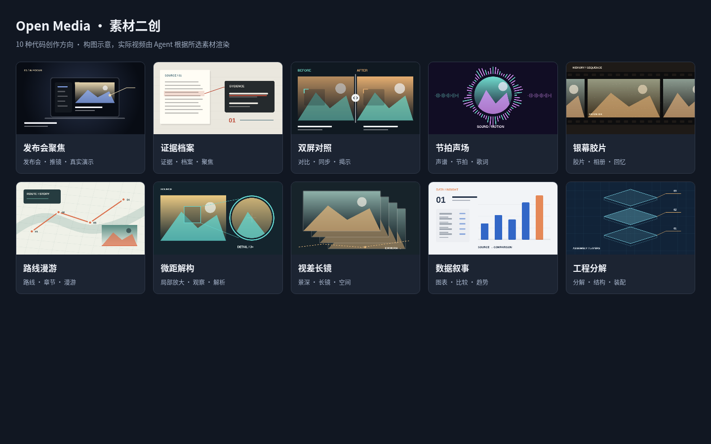

# MCP 素材二创

先开启 MCP 服务，再在 MCP 弹窗中开启“素材二创”，选择当前工程素材与视觉风格。每种风格自动附带默认提示词，定义其构图、运动、材质和检查要求；“创作要求”是用户额外提示，不会替代默认风格。

外部 Agent 读取合并后的 `effectivePrompt`，理解源素材并在自己的执行环境编写动画代码，渲染真实视频片段，随后导入当前工程、添加到轨道，与原视频、字幕、配音、音乐和转场融合。代码执行不在 Open Media 内完成，开启配置也不会自动发起生成。

## 从素材到成片

- **选择素材**：列表显示当前工程实际可用图片、视频的数量与已选数量，可选择全部可用视觉素材。搜索显示匹配数，音频与内置包装素材不计入视觉素材数量。
- **自动附加要求**：`workflowPrompt` 提供代码生成、渲染与融合流程，`stylePrompt` 提供当前风格要求，`userPrompt` 保留额外创作要求；`effectivePrompt` 合并三者。切换风格更新默认提示，用户文本保留。
- **补充图片与音乐**：仅在创作需要时生成；先检查用户当前所选模型和运行环境，所选模型可用就优先调用 MCP 图像／音乐生成工具，不可用再由 Agent 生成；不能改用其他已下载模型。用户明确要求 Agent 自制时可覆盖默认方式，任务忙碌时等待，未知或检查失败时先查询。
- **代码生成**：Agent 通过素材探测、抽帧与分块读取接口获得真实内容，按项目尺寸和帧率编写确定性动画代码。先检查关键帧和低清小样，再编码视频。
- **回传融合**：使用分块上传或公开直链导入取得视频 `assetId`，再通过普通剪辑工具放入轨道并调整节奏与声音。
- **检查成片**：读取最终合成帧、渲染短区间预览，检查遮挡、黑帧、字幕和音量后继续改进。

全部 25 种风格都提供外部代码渲染提示词，其中原有 15 种另支持内置 `motion_clip_generate` 二维预设快捷路径。快捷路径每次支持 1–16 镜、每镜 2–12 秒、配色、节奏、标志图片与配乐；这是单次预设渲染限制，不影响可选素材数量。新增 10 种风格需要外部 Agent 编写和执行动画代码，不能改用通用预设冒充对应效果。外部 Agent 所需的渲染能力缺失时应说明实际限制。

已合成到视频内的文字、背景和动画需要修改时，应重新渲染；视频进入时间线后可以正常裁剪、分割和融合，源文件保留。

## 25 种视觉风格

### 新增 10 种代码渲染风格

这些风格的提示词描述具体的素材处理、镜头结构与检查方法，适用于不同主题的用户素材。风格不包含预先生成的成片；Agent 根据当前素材、画幅和额外要求制作实际视频。

| 风格 | MCP 标识 | 画面与运动特点 |
| --- | --- | --- |
| 发布会聚焦 | `product-keynote` | 真实截图和录屏居于舞台中央，从全景推进到功能重点，再定格展示结果。 |
| 证据档案 | `evidence-dossier` | 文档、图片与录屏形成档案台，原文局部放大、划线和来源标注随镜头对应。 |
| 双屏对照 | `split-compare` | 成对素材统一尺度与动作起点，以滑动分界、同步推近和成对标注呈现差异。 |
| 节拍声场 | `lyric-spectrum` | 主素材配合真实音频包络、波形或频谱；有歌词时按时间揭示，没有音频时使用明确的固定节奏。 |
| 银幕胶片 | `vintage-film` | 胶片片门、颗粒与柔和漏光串联真实照片和视频，缓慢推进后保留稳定阅读时间。 |
| 路线漫游 | `route-atlas` | 路线逐段展开，镜头沿路径经过素材站点，最后拉回全程；位置未知时使用抽象路径示意。 |
| 微距解构 | `macro-lens` | 全景保留主体，局部放大窗与取样框对应，通过整体—局部—整体的结构解释细节。 |
| 视差长镜 | `parallax-panorama` | 前景、主体与背景沿连续镜头路径形成不同幅度的运动；没有可靠分层时采用整幅素材轻推移。 |
| 数据叙事 | `data-story` | 源素材中的可核对数据逐步转化为图表，数值、图形与标签同步变化并保留共同尺度。 |
| 工程分解 | `blueprint-explode` | 已知部件或界面模块沿装配轴展开、标注并复位；只有真实几何和渲染条件具备时才进行三维剖切。 |

下图是这 10 种风格的静态设计示意，展示构图和配色方向，不是已渲染的视频帧或最终效果验证。



### 原有 15 种风格与二维快捷预设

| 风格 | MCP 标识 | 画面与运动特点 |
| --- | --- | --- |
| 纸感手绘 | `paper-ink` | 纸张颗粒、铅笔线框与逐格轻摆，适合手作、生活和温暖叙事。 |
| 等轴卡片 | `iso-cards` | 等轴网格、层叠基座与弹性升起，展示产品模块和信息结构。 |
| 扁平跃动 | `flat-pop` | 大胆色块、圆点与弹性入场，让素材在清晰构图中接力。 |
| 极简线描 | `line-focus` | 细线、圆环与留白，配合轻缓平移和标题揭示。 |
| 柔光立体 | `studio-depth` | 柔光球体、层次阴影和悬浮卡片，形成产品展台的空间感。 |
| 柔形律动 | `shape-rhythm` | 圆弧、胶囊与缩放呼应，以图形节奏连接素材和文字。 |
| 知识贴纸 | `sticker-notes` | 白边卡片、网格和重点标签，适合讲解、步骤和知识总结。 |
| 科技视窗 | `tech-hud` | 精细网格、定位括角与环形标尺，突出数据和操作画面。 |
| 杂志拼贴 | `editorial-collage` | 撕纸、半调点阵与错位叠层，给照片和观点鲜明的版面节奏。 |
| 极光玻璃 | `aurora-glass` | 弥散光斑、透明面板和轻缓漂移，适合科技介绍与视觉展示。 |
| 几何构成 | `geometric-grid` | 圆、方块和网格按节奏错位，强调秩序与色彩对比。 |
| 霓虹复古 | `neon-retro` | 落日光晕、透视网格与霓虹色带，营造复古电子气氛。 |
| 像素节拍 | `pixel-arcade` | 像素边框、阶梯色块与离散步进，适合游戏和轻快记录。 |
| 流彩色团 | `liquid-color` | 色团交错与呼吸缩放，让素材随有机节奏出现。 |
| 活力花字 | `expressive-type` | 醒目标题、放射贴片和弹性强调，适合人物、日常和轻松表达。 |

下图展示同一组示例素材的 15 种风格配色与版式。


上图仅演示内置快捷合成器的二维图层、预绘光影与关键帧组合：等轴与柔光风格不生成三维模型；柔形风格不改变素材的连续轮廓；流彩不执行流体模拟，玻璃也不计算逐帧折射。像素与贴纸装饰保留源素材本身的内容。

## MCP 调用

`motion_brief_get` 自动刷新图像与音乐的本地运行条件，通过 `additionalAssetGeneration` 返回 `checked`、`busy`、默认策略及两类能力的 `selectedModelId`、`availability`、`route`、`readyModelIds`。`readyModelIds` 最多包含用户当前所选模型，不是全部已下载模型。未完成检查时返回 `unknown`，Agent 应调用 `open_media_ai_status({probeRuntime:true})`，读取其 `generationCapabilities` 后再决定；`project_get` 中的配置快照不执行模型探测。检测不加载大模型，也不保证实际推理成功。

补充素材默认通过 `open_media_image_generate`／`open_media_music_generate` 使用用户当前所选模型生成。省略 `modelId` 沿用当前选择，传入其他模型会被拒绝。使用 `destination: assets` 或 `timeline`；背景音乐使用 `instrumental: true`。等待真实生成成功后再处理素材。对应用户所选模型不可用、或用户明确要求 Agent 自制时，由 Agent 生成后上传或导入工程。不自动下载、修复模型，不把忙碌或查询失败视作无模型。补充素材不改变已选素材配置，也不开放未选中的既有视觉素材。

Agent 先调用 `open_media_motion_brief_get` 读取当前工程配置与合并提示词，再结合 `open_media_motion_style_list` 查询每种风格的默认 `prompt`、配色与能力说明。配置查询同步返回 `enabled`、`ready`、`errors`、素材、风格、创作目标及工程版本；功能未启用时也可读取，但不能执行生成。配置只能由用户在 MCP 弹窗修改。

风格的 `presetSupported` 明确是否支持内置二维快捷合成。原有 15 种为 `true`，新增 10 种为 `false`；选择新增风格时，brief 中 `workflow.presetGenerationTool` 为 `null`，应执行外部代码渲染流程。此时调用预设生成工具会返回不支持提示，不会静默替换成其他效果。`generationMode` 仍为 `agent-code-render`，外部代码产生的实际视频通过素材上传或导入接口回传，再与工程内其他片段融合。

可选快捷工具 `open_media_motion_clip_generate` 接收 Agent 组织好的分镜，检查方案或编码二维预设效果视频；它不负责调用大语言模型生成创意。场景只能引用用户选定的图片或视频，标志图片也必须从这些所选素材中的图片取用。`musicAssetId` 可引用当前工程已有的音频，音乐不列在二创视觉素材选择器中。`styleId` 可省略并沿用用户选定风格，不能由 Agent 换成其他风格。

先读取用户配置：

```json
{
  "name": "open_media_motion_brief_get",
  "arguments": {}
}
```

假设用户已启用素材二创、选择科技视窗风格，并勾选示例中的图片、视频与标志图片；配乐音频已导入当前工程。Agent 分析后准备了两镜介绍短片，此示例先检查方案。占位 ID 和工程版本必须替换为实际值；无需配乐或标志时省略对应字段。

```json
{
  "name": "open_media_motion_clip_generate",
  "arguments": {
    "styleId": "tech-hud",
    "title": "从问题到发现",
    "scenes": [
      {
        "assetId": "image-asset-id",
        "heading": "提出问题",
        "caption": "用一张图片建立主题和观察重点。",
        "duration": 4
      },
      {
        "assetId": "video-asset-id",
        "trimIn": 1,
        "heading": "观察变化",
        "caption": "用实际画面解释过程与结论。",
        "duration": 5
      }
    ],
    "destination": "assets",
    "tempo": "balanced",
    "accent": "#5BE2DA",
    "background": "#0A1925",
    "textColor": "#E2F6F5",
    "musicAssetId": "audio-asset-id",
    "musicVolume": 0.2,
    "logoAssetId": "logo-image-asset-id",
    "sourceAudio": false,
    "dryRun": true,
    "expectedProjectId": "current-project-id",
    "expectedRevision": 12
  }
}
```

`dryRun: true` 只校验并返回每镜起止时间、实际时长、配色和提示，不创建素材或修改轨道。确认方案后，用相同参数将 `dryRun` 改为 `false` 执行；工程版本应使用调用时的实际版本。

两种调用都会返回任务 ID，通过 `open_media_job_get({"id":"返回的任务 ID"})` 查询进度与结果，也可用 `open_media_job_cancel` 取消。正式生成完成后，结果包含视频的 `assetId`、来源 `sourceAssetIds`、实际时长、尺寸与 `warnings`。使用该 `assetId` 调用普通片段添加工具，即可选择轨道和时间位置。

`destination` 默认为 `assets`，只将效果视频加入项目素材。需要同时放入时间线时，可设置 `destination: "timeline"`，并用 `insert` 指定 `trackId` 和 `start`；生成视频会作为一个普通片段加入。生成时会校验当前工程与版本，整次提交可一步撤销。

完整连接方式、素材导入和任务约定见 [MCP 文档](MCP.md)。

## 设计研究参考

[动态视觉风格研究](https://vincentwei1021.github.io/mg-styles-15/)：观察版式、色彩、入场、停留与收尾的节奏，形成适用于用户素材的独立实现；未使用参考网站的源码或视频素材。

新增风格研究了公开的代码示例、动画制作提示词与布局文档，提炼为本项目独立编写的创作要求。此次研究以阅读公开资料为主，没有将示例视频观看或性能实测作为验证结果，也没有复制来源项目的代码或媒体素材。

| 研究方向 | 公开资料 | 用于本项目的设计要点 |
| --- | --- | --- |
| 真实素材舞台与镜头 | [舞台制作要求](https://github.com/openfilm/openfilm/blob/main/packages/openfilm/skills/keynote/SKILL.md)、[录屏演示要求](https://github.com/openfilm/openfilm/blob/main/packages/openfilm/skills/screen-demo/SKILL.md) | 原始画面证明标题要点，镜头围绕真实动作与结果移动。 |
| 证据与比较 | [信息图构图要求](https://github.com/jincheng2026/jc-remotion-skills/blob/main/skills/remotion-design-system/references/infographic.md) | 原文、来源和结论分级，双屏保持同等尺度。 |
| 声音驱动动画 | [频谱与波形示例](https://github.com/remotion-dev/skills/blob/main/skills/remotion-best-practices/remotion-markup/audio-visualization.md)、[歌词制作要求](https://github.com/openfilm/openfilm/blob/main/packages/openfilm/skills/lyric-video/SKILL.md) | 读取真实音频能量，所有视觉变化沿同一时间轴。 |
| 胶片叙事 | [照片与视频质感要求](https://github.com/openfilm/openfilm/blob/main/packages/openfilm/skills/vintage-film/SKILL.md) | 保留原始主体，质感变化不遮挡重要信息。 |
| 路线与章节镜头 | [路径运动示例](https://github.com/maplibre/maplibre-gl-js/blob/main/test/examples/animate-a-point-along-a-route.html)、[章节镜头示例](https://github.com/maplibre/maplibre-gl-js/blob/main/test/examples/fly-to-a-location-based-on-scroll-position.html) | 路径按距离推进，镜头跟随并在站点减速。 |
| 局部放大与数据 | [局部放大示例](https://github.com/ManimCommunity/manim/blob/main/docs/source/examples.rst)、[图表插值实现](https://github.com/ManimCommunity/manim/blob/main/manim/mobject/graphing/probability.py) | 取样框与放大窗对应，数值和图形同步插值。 |
| 连续镜头与视差 | [镜头控制文档](https://github.com/motion-canvas/motion-canvas/blob/main/packages/docs/docs/getting-started/camera.mdx)、[分段运动文档](https://github.com/pmndrs/drei/blob/master/docs/controls/scroll-controls.mdx) | 以统一帧时间控制连续镜头、层次速度和显隐。 |
| 展开、复位与剖切 | [部件位置插值实现](https://github.com/zxcwhhyy/spatial-3d-audio/blob/main/spatialModel.js)、[剖切与遮挡示例](https://github.com/mrdoob/three.js/blob/dev/examples/webgl_clipping_stencil.html) | 部件保留原位与展开位置，检查引线、遮挡和复位路径。 |
