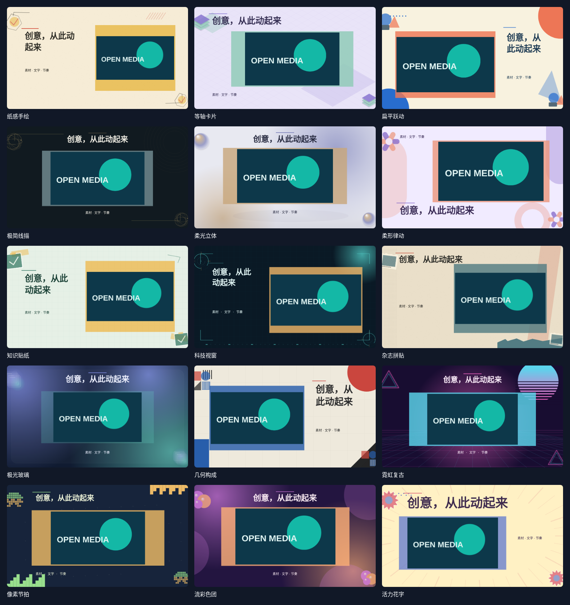

# 效果片段

使用当前工程中的图片、视频与每镜文字，生成带统一配色、版式和动画节奏的效果视频。编码完成后，视频加入项目素材；可按普通素材插入时间线，继续分割、裁切、调速、叠加字幕或添加转场。

合成使用本地素材与本地绘制的装饰，无须下载生成模型，也不会替用户上传素材到外部网站。画面沿用当前工程的尺寸和帧率，并根据横屏、方形或竖屏调整布局。生成保留原始素材与现有时间线，不会自动加入多条背景、文字或装饰轨道。

在项目素材列表选择图片或视频，右键点击“生成效果片段”，即可在剪辑界面右侧设置；支持 Ctrl／⌘ 多选与 Shift 连选。也可从时间线视频或图片片段的右键菜单进入，使用其源素材生成。

## 素材与分镜

- 先通过剪辑工作区的素材导入功能准备图片、视频、音乐或标志图片，再从当前工程已有素材中选择；风格配置中不另外导入文件。
- 每次组合 1–16 镜，按场景顺序选择图片或视频，填写标题、说明与时长。每镜默认 4 秒，可设置为 2–12 秒；视频还可指定素材起点。
- 视频剩余时间不足时，场景按剩余长度缩短，并返回提示。视频保持原速，不自动补帧或重复播放。
- 可调整强调色、背景色、文字颜色，以及舒缓、均衡、轻快三档动画节奏。节奏控制入场速度与运动幅度，不执行音乐节拍识别。
- 可使用项目中的图片作为标志，音频作为背景音乐；音乐按成片时长循环并在首尾淡入淡出。视频原声默认关闭，可选择保留。
- 生成完成后，在项目素材中查看效果视频，再将其添加到需要的位置，使用现有的轨道工具继续剪辑。

文字、说明、装饰和动画已编码到效果视频画面中，不是独立字幕或图层；需要修改这些内容时，调整分镜或风格参数后重新生成。效果视频进入时间线后，编辑方式与其他视频片段一致。

## 15 种风格

| 风格 | MCP 标识 | 画面与运动特点 |
| --- | --- | --- |
| 纸感手绘 | `paper-ink` | 纸张颗粒、铅笔线框与逐格轻摆，适合手作、生活和温暖叙事。 |
| 等轴卡片 | `iso-cards` | 等轴网格、层叠基座与弹性升起，展示产品模块和信息结构。 |
| 扁平跃动 | `flat-pop` | 大胆色块、圆点与弹性入场，让素材在清晰构图中接力。 |
| 极简线描 | `line-focus` | 细线、圆环与留白，配合轻缓平移和标题揭示。 |
| 柔光立体 | `studio-depth` | 柔光球体、层次阴影和悬浮卡片，形成产品展台的空间感。 |
| 柔形律动 | `shape-rhythm` | 圆弧、胶囊与缩放呼应，以图形节奏连接素材和文字。 |
| 知识贴纸 | `sticker-notes` | 白边卡片、网格和重点标签，适合讲解、步骤和知识总结。 |
| 科技视窗 | `tech-hud` | 精细网格、定位括角与环形标尺，突出数据和操作画面。 |
| 杂志拼贴 | `editorial-collage` | 撕纸、半调点阵与错位叠层，给照片和观点鲜明的版面节奏。 |
| 极光玻璃 | `aurora-glass` | 弥散光斑、透明面板和轻缓漂移，适合科技介绍与视觉展示。 |
| 几何构成 | `geometric-grid` | 圆、方块和网格按节奏错位，强调秩序与色彩对比。 |
| 霓虹复古 | `neon-retro` | 落日光晕、透视网格与霓虹色带，营造复古电子气氛。 |
| 像素节拍 | `pixel-arcade` | 像素边框、阶梯色块与离散步进，适合游戏和轻快记录。 |
| 流彩色团 | `liquid-color` | 色团交错与呼吸缩放，让素材随有机节奏出现。 |
| 活力花字 | `expressive-type` | 醒目标题、放射贴片和弹性强调，适合人物、日常和轻松表达。 |

下图展示同一组示例素材的 15 种风格配色与版式。



这些风格使用二维图层、预绘光影与关键帧组合：等轴与柔光风格不生成三维模型；柔形风格不改变素材的连续轮廓；流彩不执行流体模拟，玻璃也不计算逐帧折射。像素与贴纸装饰保留源素材本身的内容。

## MCP 调用

`open_media_motion_style_list` 同步返回风格目录、配色、标签与能力说明，可用 `search` 搜索。`open_media_motion_clip_generate` 根据场景预检方案或编码效果视频，素材 ID 均来自当前打开的工程。外部素材应先通过素材导入工具加入项目。

先查询风格：

```json
{
  "name": "open_media_motion_style_list",
  "arguments": {}
}
```

以下示例先检查两镜科技介绍短片的安排。将占位 ID 替换成当前工程与素材的实际 ID；未准备音乐或标志时，可省略对应字段。

```json
{
  "name": "open_media_motion_clip_generate",
  "arguments": {
    "styleId": "tech-hud",
    "title": "从问题到发现",
    "scenes": [
      {
        "assetId": "image-asset-id",
        "heading": "提出问题",
        "caption": "用一张图片建立主题和观察重点。",
        "duration": 4
      },
      {
        "assetId": "video-asset-id",
        "trimIn": 1,
        "heading": "观察变化",
        "caption": "用实际画面解释过程与结论。",
        "duration": 5
      }
    ],
    "destination": "assets",
    "tempo": "balanced",
    "accent": "#5BE2DA",
    "background": "#0A1925",
    "textColor": "#E2F6F5",
    "musicAssetId": "audio-asset-id",
    "musicVolume": 0.2,
    "logoAssetId": "logo-image-asset-id",
    "sourceAudio": false,
    "dryRun": true,
    "expectedProjectId": "current-project-id",
    "expectedRevision": 12
  }
}
```

`dryRun: true` 只校验并返回每镜起止时间、实际时长、配色和提示，不创建素材或修改轨道。确认方案后，用相同参数将 `dryRun` 改为 `false` 执行；工程版本应使用调用时的实际版本。

两种调用都会返回任务 ID，通过 `open_media_job_get({"id":"返回的任务 ID"})` 查询进度与结果，也可用 `open_media_job_cancel` 取消。正式生成完成后，结果包含视频的 `assetId`、来源 `sourceAssetIds`、实际时长、尺寸与 `warnings`。使用该 `assetId` 调用普通片段添加工具，即可选择轨道和时间位置。

`destination` 默认为 `assets`，只将效果视频加入项目素材。需要同时放入时间线时，可设置 `destination: "timeline"`，并用 `insert` 指定 `trackId` 和 `start`；生成视频会作为一个普通片段加入。生成时会校验当前工程与版本，整次提交可一步撤销。

完整连接方式、素材导入和任务约定见 [MCP 文档](MCP.md)。

## 设计研究参考

[动态视觉风格研究](https://vincentwei1021.github.io/mg-styles-15/)：观察版式、色彩、入场、停留与收尾的节奏，形成适用于用户素材的独立实现；未使用参考网站的源码或视频素材。
