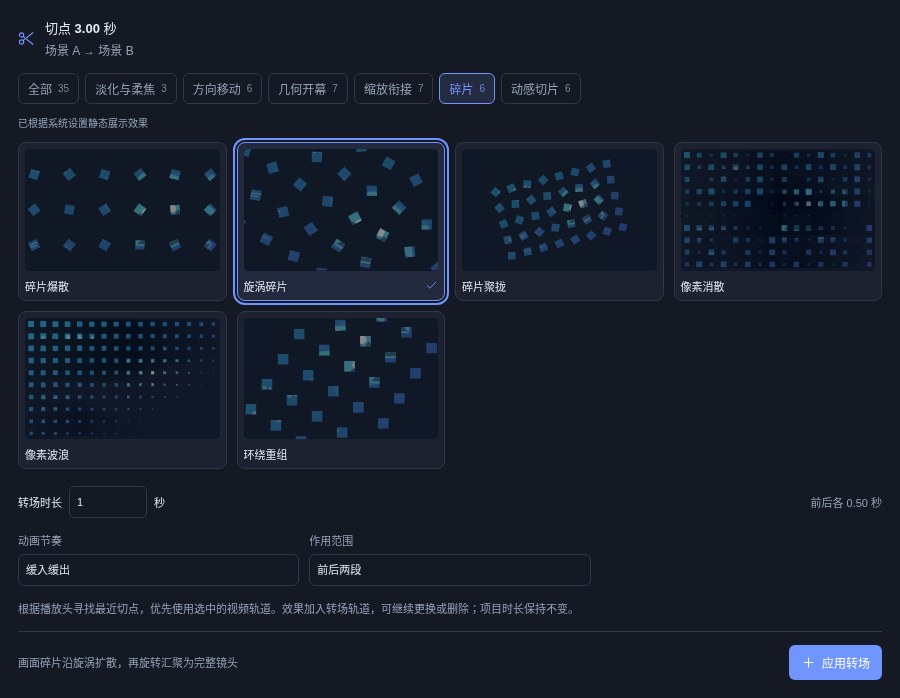
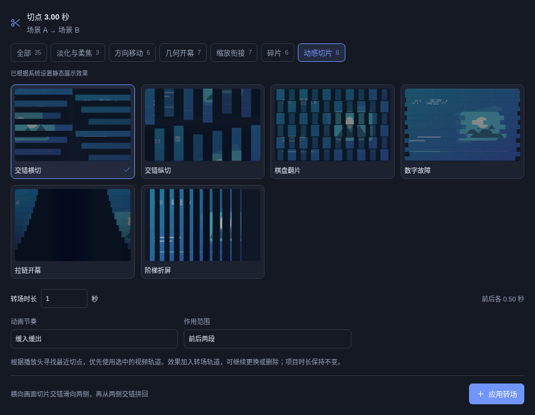

# 碎片与切片转场研究

本轮从连续短区间观察粒子收放、画面切片、翻面、遮挡和换景节奏，再将这些规律做成作用于用户源画面的通用转场。研究视频中的人物、图形、文字、音乐和品牌包装均未收入软件素材。

## 观察范围与访问记录

研究日期：2026-10-19。当前记录包括 **6 条新来源视频的 14 段短区间，共 55 秒、440 帧**，以及 **5 条历史缓存视频中新查看的 16 段区间，共 59 秒、472 帧**。合计 30 段、114 秒、912 帧，均按 8 fps 抽帧并查看；没有完整观看这些视频。另查看 13 条视频的稀疏概览来选择观察区间，概览不作为精确运动依据，也不加入连续帧总数。

首次搜索请求返回 HTTP 412 后，已停止该来源网络访问，继续复用历史缓存。其他公开来源使用普通公开搜索和播放器，串行访问、请求间隔至少 15 秒，优先低清或短区间；未绕过登录、访问限制或验证码。其中三条新来源只下载播放器开头约 12 秒的低清分段，并仅观察已取得区间；另三条选取短区间，未完整观看。页面可打开不等于已经观看。详细来源、观察区间、访问状态和证据摘要见[研究索引](research/transition-study-2026-10-19.json)。研究临时视频与联系表不随仓库分发。

## 能实际确认的运动

| 来源与时间 | 连续帧中看到的内容 | 可通用的设计方向 |
| --- | --- | --- |
| [样本 A](https://vimeo.com/252110692#t=53s)，00:53–00:57 | 完整晶体向外分散为较大的几何块与细粒，后段另一组黑色片状形体分离。属于物件动画，并非整张画面的碎裂。 | 真实画面碎片保留自身纹理；位移、少量旋转与缩放共同表现分离。 |
| [样本 B](https://vimeo.com/178854777#t=47s)，00:47–00:51 | 有序点阵先散乱再聚合，颗粒有大小层次，中心标记仍可识别。 | 析出与析入共用确定的布局，保持粒度和终点，避免每帧随机闪烁。 |
| [样本 B](https://vimeo.com/178854777#t=14s)，00:14–00:18 | 物件绕竖轴翻到另一面，朝向边缘时宽度最窄。 | 使用二维宽度变化表达翻片；不将其宣传为三维物理模拟。 |
| [样本 C](https://vimeo.com/cadadas/showreel-motion-2011#t=85s)，01:25–01:29 | 窄竖带扫过后出现新面板，面板分为竖片翻面，随后各条分别升降。 | 错峰移动和翻面分开设计，结束后恢复对齐。 |
| [样本 G](https://vimeo.com/1186379740#t=2s)，00:02–00:06 | 圆形面快速放大换景，多列图形随后翻面，侧面变窄。 | 分离遮幕与翻面的阶段；不复制原图形。 |
| [样本 H](https://vimeo.com/1109754542#t=8s)，00:08–00:12 | 新构图从右进入，覆盖旧背景，其余多处采用直接剪切。 | 方向性揭幕与直接切换都保留，避免把每次剪切算成新动效。 |
| [样本 I](https://vimeo.com/735160929#t=0s)，00:00–00:04 | 不同位置的球体逐次聚成中心形状，完成后保持稳定。 | 给聚合过程一个明确终点和稳定停留。 |
| [历史样本 D](https://www.bilibili.com/video/BV1NU4y1e742/?t=40)，00:40–00:43 | 斜片交错、横向矩形短时错位，原画面仍可辨认。 | 动效集中于切点附近；条片有稳定身份和方向。 |
| [历史样本 E](https://www.bilibili.com/video/BV1AJ4m1g7cs/?t=17)，00:17–00:21 | 多个竖向画面带依次替换，栏位边界清楚。 | 统一总时长，分别设置切片延迟；横竖画幅都保持覆盖。 |
| [历史样本 F](https://www.bilibili.com/video/BV13b411w7Sb/?t=89)，01:29–01:33 | 窄柔化竖带扫过时换景，人物位置和行进方向基本延续。 | 模糊只处理局部带宽；真实镜头匹配依赖源构图。 |

样本中的物件动画、文字变化、实拍遮挡和全画面转场分别记录。观察只能支持运动规律，不足以确定原作的三维结构、物理参数或精确缓动。

## 原创设计与实现

以下转场由项目自行实现，使用当前视频画面作为切片内容，不绑定任何研究视频、题材、音乐或固定装饰。这些设计结合了观察规律和用户提出的碎片析出、析入要求，**不代表每项都有直接对应的参考镜头**。

| 转场 | 标识 | 画面变化 |
| --- | --- | --- |
| 碎片爆散 | `fragment-burst` | 画面分为碎片，旋转并向外散开，再聚合为下一镜头。 |
| 旋涡碎片 | `fragment-vortex` | 碎片围绕中心旋转扩散，随后反向汇聚。 |
| 碎片聚拢 | `fragment-collapse` | 碎片向中心收拢，再由中心展开。 |
| 像素消散 | `pixel-dissolve` | 像素块错峰缩小消失，再逐块还原。 |
| 像素波浪 | `pixel-wave` | 像素块沿对角方向形成消散与重组波浪。 |
| 交错横切 | `slice-stagger` | 横向切片交错滑向左右，再交错拼回。 |
| 交错纵切 | `slice-vertical` | 纵向切片交错滑向上下，再交错拼回。 |
| 棋盘翻片 | `checker-flip` | 棋盘格交错收起，再翻开为下一镜头。 |
| 环绕重组 | `tile-orbit` | 画面块围绕中心运动后重新对齐。 |
| 数字故障 | `glitch-slices` | 横向条带短促错位，随后恢复完整画面。 |
| 拉链开幕 | `zipper-slices` | 画面切片沿次序分离并重新合拢。 |
| 阶梯折屏 | `stepped-shutter` | 各层画面按阶梯节奏收起与展开。 |

沿用现有转场的切点、时长和缓动参数；默认前半段析出、后半段析入，也可以仅作用于单侧。运动由时间和确定的布局计算，暂停、跳转及再次播放时应保持一致，不能每帧产生新的随机布局。

转场库总计 **35 种**。新增效果分为“碎片”和“动感切片”两类，每类 6 种；悬停或选中播放单张预览，并遵循系统减少动态效果设置。

## 验证

本轮使用自制移动测试画面，分别检查素材卡片、连续播放和实际编码文件。测试画面包含可追踪的移动纹理，避免静态图片掩盖视频停帧问题。

- 12 种新增效果：横竖画幅的连续播放、析出与析入、完整首尾、切点、缓动、单侧作用范围，以及工程保存后重新打开均通过。
- 浏览器实际导出分两批验证，共 48 秒，输出文件均完整解码；同时回归已有 23 种预览与其中 11 种实际导出。
- 原生导出逐项编码并解码 12 个两秒视频，检查 40 帧完整性、首尾恢复、透明边缘及效果互不重复；已有 10 种原生转场导出回归通过。
- 原生取帧与预览进行 **48 张同时间点对照**（12 种 × 横竖幅 × 析出/析入）：RGB 平均误差最大 5.482/255，允许一像素边缘抗锯齿差异后，最大几何差异为画面的 0.035%。检查过程中修正了分块居中与叠加坐标重复截断造成的偏移。
- 素材库检查 35 项分类、12 张新增卡片的真实动画、单卡播放、键盘选择和动态减少动画设置；SVG 卡片与 Canvas 同帧比对通过。
- 编辑器与 MCP 覆盖 35 项效果，检查新增与修改、切点约束、锁定规则、撤销重做和保存恢复。

导出使用分块裁切、缩放、旋转和叠加，避免在整个画面上逐像素计算复杂几何。当前测试环境为 Linux x86_64，原生 CPU 编码；未将这些结果作为 macOS 或 Windows 桌面实机性能结论。原生整数像素采样与预览的边缘抗锯齿可能有少量差异。

最终实现的 720p 测量使用两秒、20 fps 视频及 0.8 秒双侧转场：40 块旋涡碎片编码耗时 4.685 秒，160 块像素波浪耗时 7.228 秒；计时包括任务启动至完成和文件信息验证，之后分别完整解码 40 帧。

另外检查了 20 秒视频中位于第 19 秒的转场：前段能及时开始编码，不会等待切点后才输出；极窄的 2 × 1920 取帧也完成真实 PNG 编码与解码，未出现零宽裁切错误。

可复用验证入口：`tests/fragment-transitions.test.mjs`、`tests/browser/fragment-transitions.cjs`、`tests/browser/fragment-gallery.cjs`、`tests/browser/editor-transitions-segments.cjs`，以及原生测试 `fragment_transitions_encode_live_textures_and_restore_both_endpoints`。性能、晚切点和跨端对照用例需要显式运行，避免将机器速度差异作为普通测试的通过条件。
